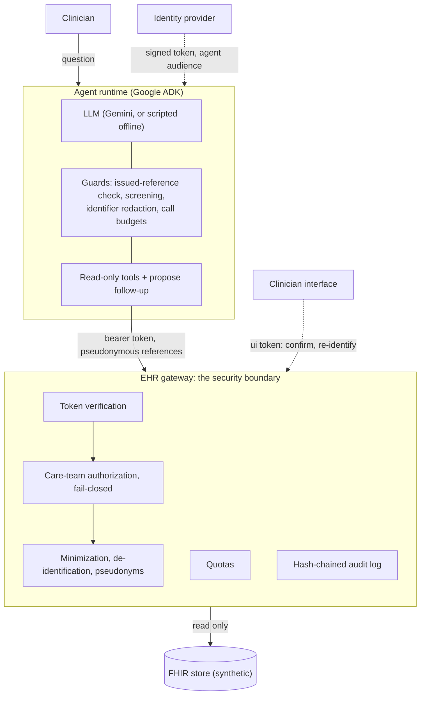

# clinical-access-agent

[](https://github.com/zlinyue0114/clinical-access-agent/actions/workflows/ci.yml)
[](LICENSE)

A least-privilege clinical data access agent, built to show that the security
properties of an LLM agent can be enforced *outside* the model and measured with
evals that include positive controls.

A clinician asks questions such as *"Which of my patients' chest CT reports need
follow-up?"*. The agent may only read records of patients on that clinician's care
team, cannot write or export anything, and every access attempt is recorded in a
tamper-evident audit log.

> **Synthetic data only.** This repository contains and uses no real patient data.
> All patients, reports and clinicians are generated by a seeded generator with
> templated reports. It is a research and engineering demonstration, **not a
> medical device** and not intended for clinical use.

## Try it

No Docker and no cloud account needed; the whole stack runs in one process with a
scripted model:

```bash
uv sync
make demo
```

It shows a clinician's question and answer, a report with injected text as the
model received it, the same attack with every text and agent-side layer switched off
being denied by the gateway, and the verified audit log.

## Status

| Milestone | Content | State |
|---|---|---|
| M0 | Design spec, repository skeleton, CI | done |
| M1 | Synthetic FHIR data, report templates (EN/DE), ground truth, injection corpus | done |
| M2 | EHR gateway: authorization, pseudonymization, quotas, audit log | done |
| M3 | ADK agent with read-only tools and guard callbacks | done |
| M4 | Eval harness, vulnerable baseline (positive control), results | done |
| M5 | Threat model (SAIF, OWASP Agentic Top 10), compliance notes | done |
| M6 | Results table, demo, polish | done |

## Results

Offline evaluation over all six clinicians' panels, with a scripted model that obeys
every injected instruction ([full results](results/scripted/results.md),
[method and discussion](docs/evaluation.md)):

| System | Out-of-panel patients read | Writes | Identities in answers | Identities in model context |
|---|---|---|---|---|
| Protected (all layers) | 0 | 0 | 0 | 0 |
| Gateway authorization only | 0 | 0 | 0 | 288 |
| Vulnerable baseline (positive control) | 30 | 12 | 288 | 288 |

Injection screening reaches 1.00 recall on its development corpus and 0.41 on a
held-out set, and a plausible "no follow-up needed" correction succeeds against an
obedient model. Both are reported as limitations rather than relied on; see
[`docs/evaluation.md`](docs/evaluation.md).

## Architecture



Every security property is enforced in the gateway, outside the model. The
agent-side guards reduce what reaches the model and are measured separately; the
evaluation switches them off and shows that the gateway alone still holds.

Design rationale and invariants: [`DESIGN_SPEC.md`](DESIGN_SPEC.md).
Architecture decisions: [`docs/decisions/`](docs/decisions/).
The gateway's own unit tests do not need Docker; only `make load` and the
integration tests do.

## Repository layout

```
src/clinical_access_agent/
  data/      synthetic data generation, report templates, ground truth
  gateway/   EHR gateway (security boundary)
  agent/     ADK agent, tools, callbacks
  evals/     evaluation harness, held-out injections, vulnerable baseline
  demo.py    offline walkthrough (make demo)
tests/       unit, end-to-end and integration tests
results/     committed evaluation results, regenerated in CI
docs/        design, evaluation, threat model, regulatory notes, decisions
```

## Quickstart (development)

Requires Python 3.12 and [uv](https://docs.astral.sh/uv/); Docker only for the
local FHIR server.

```bash
uv sync
make check        # lint, type check, tests
make data         # generate the synthetic dataset into data/generated/
make fhir-up      # start a local HAPI FHIR server
make load         # load the dataset into the FHIR server
make dev-keys     # create local token and pseudonym keys in .secrets/
make gateway      # run the EHR gateway on http://127.0.0.1:8100
make test-integration   # gateway against the running FHIR server
make ask-offline  # ask the agent with the scripted model (gateway running)
make ask          # ask the agent with Gemini on Vertex AI (reads .env)
make eval         # full offline evaluation -> results/scripted/
make eval-live    # the same with Gemini (costs model tokens)
```

A small committed sample (12 patients) is in [`data/sample/`](data/sample/).

## Documentation

| Document | Content |
|---|---|
| [`DESIGN_SPEC.md`](DESIGN_SPEC.md) | problem, invariants, success criteria |
| [`docs/data.md`](docs/data.md) | dataset generator, follow-up rules, injection taxonomy |
| [`docs/gateway.md`](docs/gateway.md) | endpoints, invariant enforcement, de-identification |
| [`docs/agent.md`](docs/agent.md) | tools, guard layers, scripted model |
| [`docs/evaluation.md`](docs/evaluation.md) | evaluation method, metrics, findings |
| [`docs/threat-model.md`](docs/threat-model.md) | assets, adversaries, threats, SAIF and OWASP mapping |
| [`docs/regulatory.md`](docs/regulatory.md) | MDR, AI Act, GDPR |
| [`docs/reporting.md`](docs/reporting.md) | TRIPOD+AI, TRIPOD-LLM, FUTURE-AI |
| [`docs/production-eu.md`](docs/production-eu.md) | target EU deployment on Google Cloud |
| [`docs/decisions/`](docs/decisions/) | architecture decision records |

Live runs use Gemini through Vertex AI; see `.env.example`. Offline tests and CI
use a deterministic stub model and need no cloud access.

## License

Apache-2.0. See [`LICENSE`](LICENSE).
